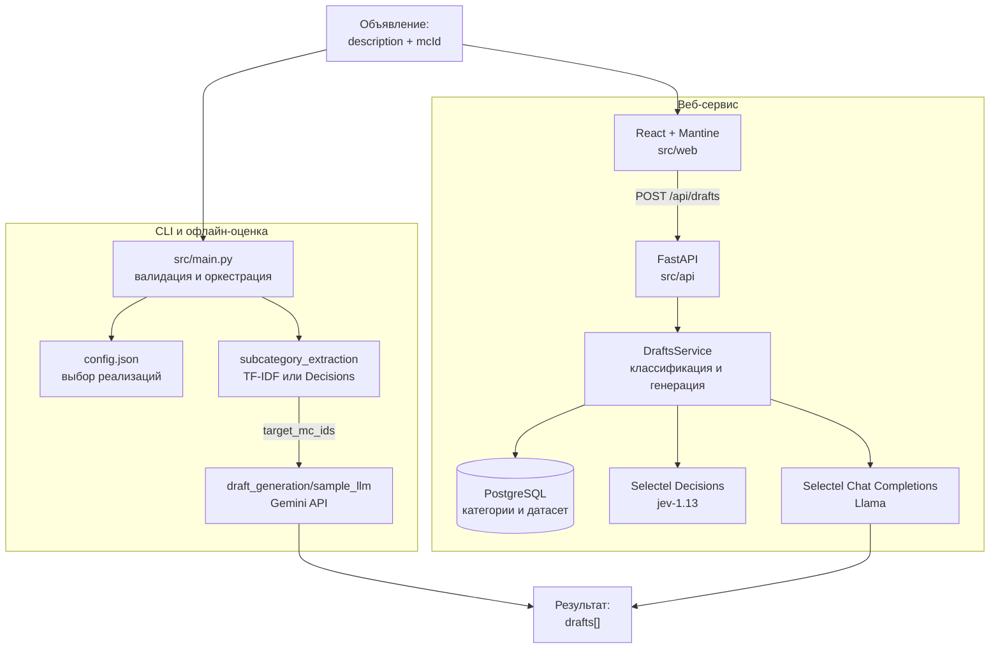
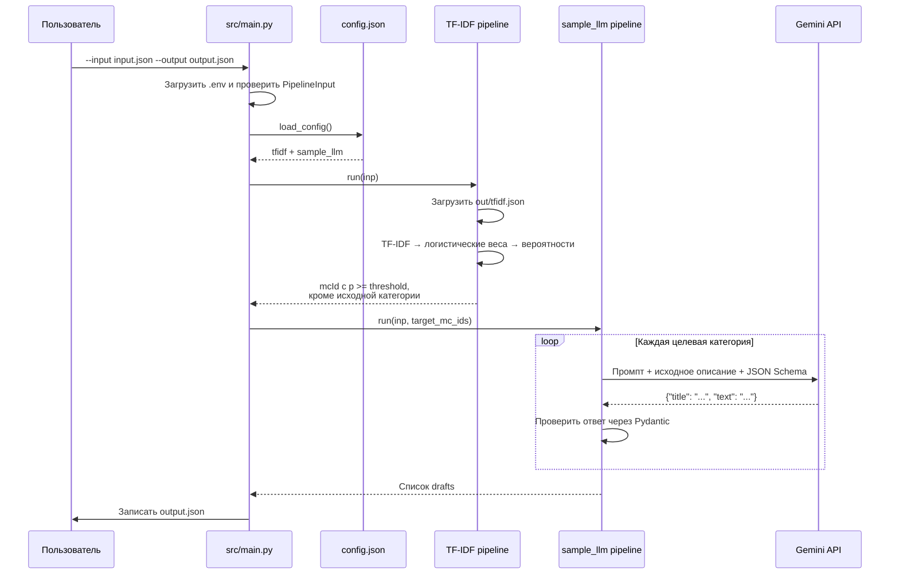
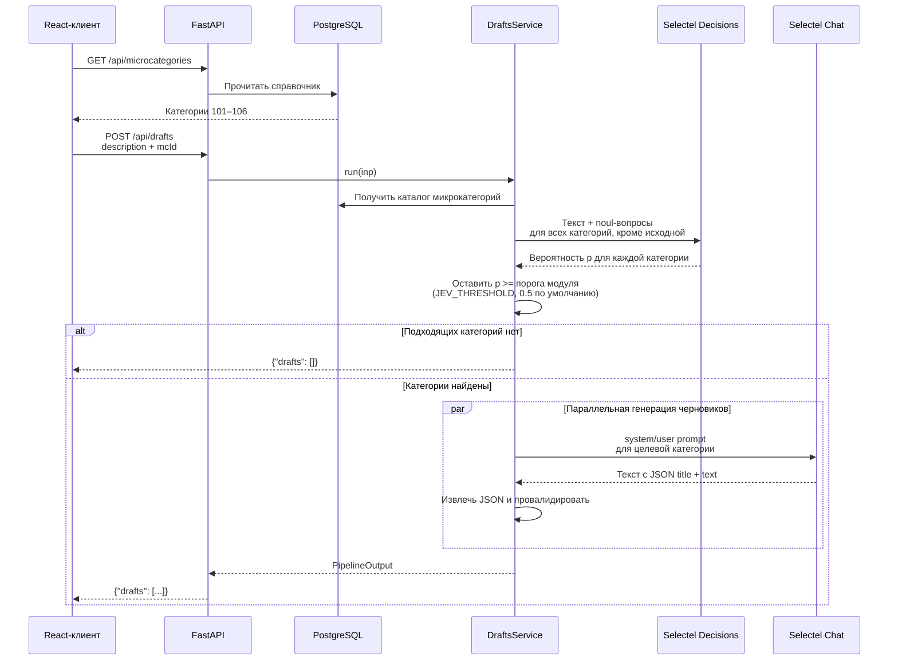
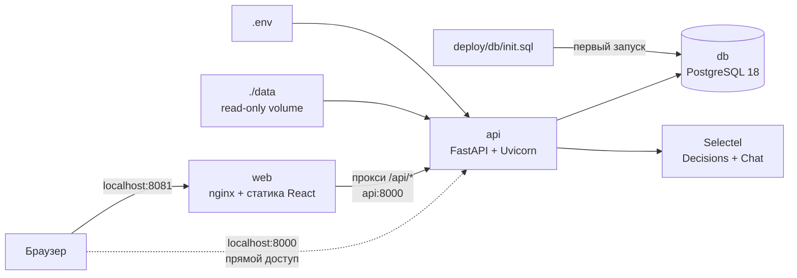
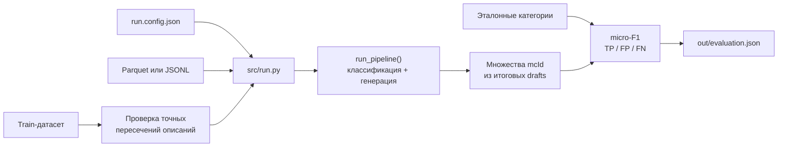

# Архитектура репозитория

По тексту объявления и его текущей микрокатегории сервис находит дополнительные
услуги из категории «Ремонт и отделка» и создаёт для них черновики объявлений.
Исходная микрокатегория исключается из результата.

В репозитории есть два пути выполнения: CLI с реализациями из `config.json` и
веб-сервис с классификацией и генерацией через Selectel. Оба используют общие
схемы данных и таблицу микрокатегорий из `src/main.py`, но веб-сервис не вызывает
CLI-пайплайн.

## Общая архитектура

## CLI

`src/main.py` читает входной JSON, проверяет его через Pydantic, загружает
выбранные модули и последовательно выполняет выделение категорий и генерацию
черновиков. Текущая конфигурация: `tfidf` + `sample_llm`.

## Веб-сервис

React-клиент получает справочник микрокатегорий и отправляет исходное объявление
в FastAPI. `DraftsService` получает вероятности дополнительных категорий через
Selectel Decisions, применяет порог и параллельно генерирует черновики через
Selectel Chat Completions.

## Docker и база данных

`docker-compose.yml` поднимает PostgreSQL, FastAPI и nginx с собранным
React-клиентом. nginx раздаёт статику и проксирует `/api/*` в контейнер `api`.

В PostgreSQL хранятся справочник `microcategories` и объявления `case_ads`.
`src/api/dataset_loader.py` идемпотентно загружает официальные train/test-данные.

## Оценка решения

`src/run.py` прогоняет полный CLI-пайплайн на датасете, извлекает категории из
итоговых черновиков и сравнивает их с эталонными множествами по micro-F1.

Классификационные баллы рассчитываются как `60 × micro-F1`. В отчёт сохраняются
метрики, конфигурация, время выполнения и полный ответ для каждой строки.
