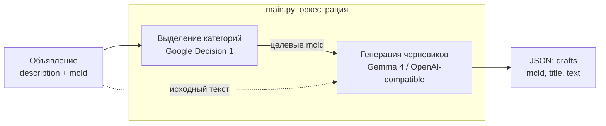

# Архитектура проекта

`main.py` выбирает модули через `config.json`; модели, провайдер генерации
и ключи задаются в локальном `.env`.

Выделение возвращает категории, отличные от исходной. Генератор использует
этот список и факты исходного объявления, создавая один черновик на категорию.
При отсутствии целей результат — `{"drafts": []}` без вызова API генерации.
Ответ проверяется перед записью JSON.

Реализации: [выделение](../src/subcategory_extraction/README.md) и
[генерация](../src/draft_generation/README.md).
Бенчмарки и статус live-проверок: [validation.md](validation.md).
