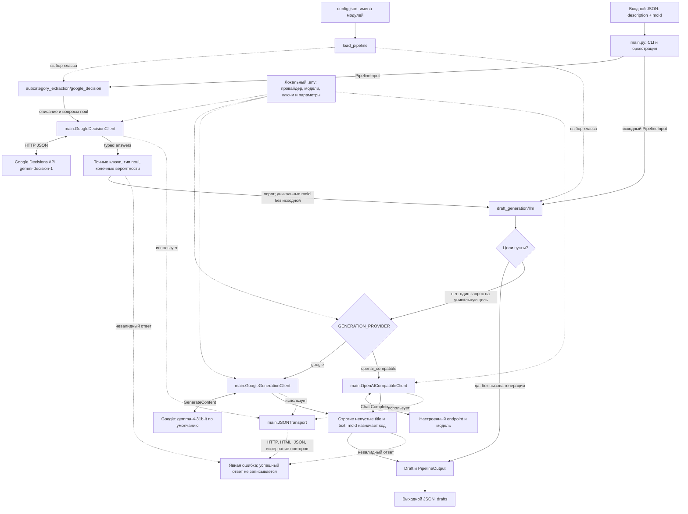
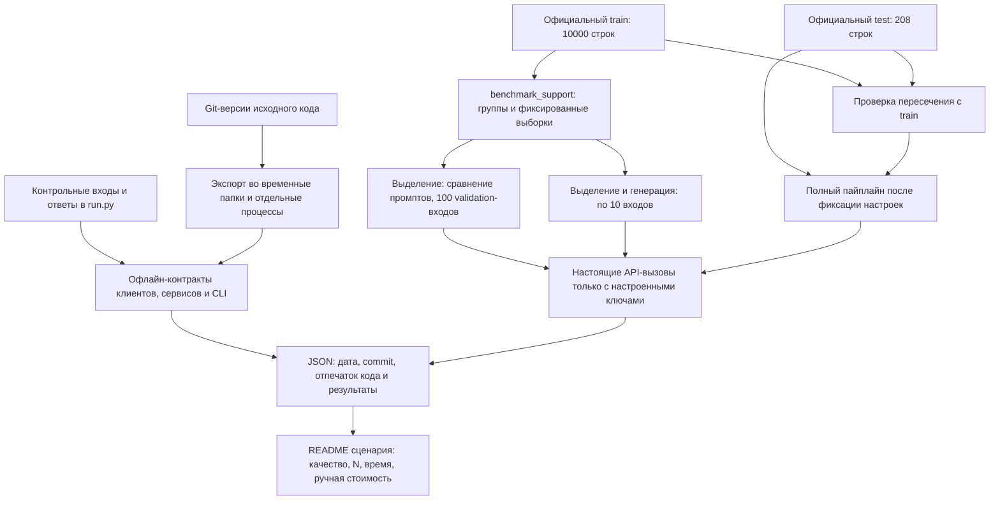

# Архитектура после rebuild

Активны два модуля: `subcategory_extraction/google_decision` и
`draft_generation/llm`. Вход, выход и таблица микрокатегорий 101–106 сохранены.

Стрелки HTTP показывают запросы и ответы; пунктир — конфигурацию, выбор
реализации и общие зависимости. Все API-клиенты используют общий класс
транспорта, но имеют отдельные настройки и экземпляры.

Для каждого объявления классификатор задаёт до пяти независимых вопросов
в одном запросе. Исходная категория не запрашивается. Пустое описание
возвращает пустые цели без API. Рабочие начальные настройки — `guided`,
порог 0.5; они не объявляются лучшими без нового validation-прогона.

Генератор получает исходный текст, а не текст другого черновика. Промпт
ограничивает его фактами об услугах целевой категории. Один вызов даёт один
черновик; повторные mcId объединяются. При ошибке одной категории частичный
результат не возвращается. JSON-схема проверяет формат, а не истинность фактов.
Отдельного LLM для фактической проверки и базы референсных объявлений нет.

Конфигурация обоих шагов проверяется при создании пайплайна до платных
вызовов. Пустые цели не вызывают метод генерации API, но не отменяют проверку
конфигурации. Ошибки не вызывают переключение провайдеров или моделей.
Транспорт ограничивает попытки, учитывает Retry-After и не следует redirects
с ключом авторизации. CLI записывает JSON только после завершения цепочки.

## Бенчмарки и данные

Общие метрики и проверки не меняются при выборе модуля. Качество выделения
считается через sklearn micro-F1, баллы за классификацию — 60 × micro-F1.
Время измеряется вокруг настоящего `run()`; офлайн-время не называется
скоростью модели. Незавершённые прогоны не получают итогового F1.

Выборка сохраняет прежние идентификаторы групп: точные нормализованные
дубликаты объединены, близкие неидентичные шаблоны отдельно не группируются.
Новый пайплайн не обучает модель на этом наборе. В итоговом test найдено
24 нормализованных совпадения с train; оценщик отражает их в отчёте.
Это не полный поиск близких дубликатов и не гарантия независимости данных.

Аудит, переразметка и сборка наборов живут отдельно в `src/dataset_annotation/`.
Прежние TF-IDF и sample_llm удалены из активного кода; их сохранённые результаты
помечены историческими. Git-версия до удаления — `2c65c3f`.

Результаты проверки и оставшиеся live-шаги: [validation.md](validation.md).
