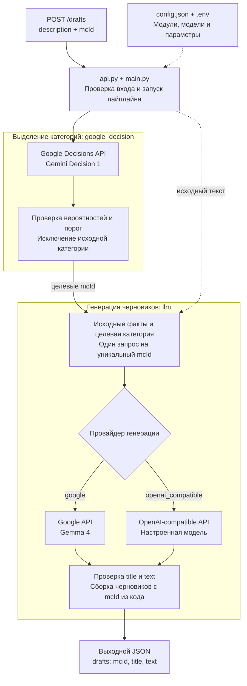

# Архитектура проекта

Сплошные стрелки показывают основной поток обработки, пунктир — конфигурацию
и передачу исходного текста непосредственно генератору.

`main.py` выбирает модули через `config.json`; модели, провайдер генерации
и ключи задаются в локальном `.env`. Внутренние классы клиентов, транспорт,
повторы запросов и устройство бенчмарков на схеме опущены.

Сервер запускается через `uv run python -m src` (`src/__main__.py`).
Входной JSON поступает через `POST /drafts`.
HTTP-адаптер `src/api.py` вызывает `run_pipeline()`;
[описание API](http-api.md) включает запуск и примеры запросов.

Выделение возвращает категории, отличные от исходной. Генератор использует
этот список и факты исходного объявления, создавая один черновик на категорию.
При отсутствии целей результат — `{"drafts": []}` без вызова API генерации.
Ответ проверяется перед отправкой JSON. Ошибка одной категории прерывает
обработку; частичный результат не возвращается. Проверка схемы не заменяет
фактическую проверку текста исполнителем.

Реализации: [выделение](../src/subcategory_extraction/README.md) и
[генерация](../src/draft_generation/README.md).
Бенчмарки и статус live-проверок: [validation.md](validation.md).
